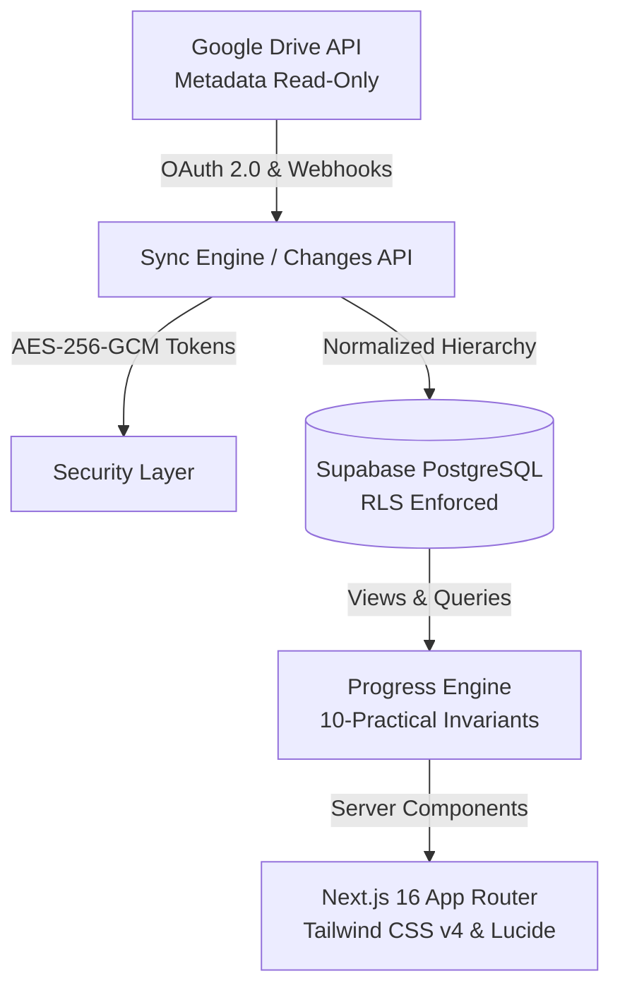

# Superior Lab Tracker

> **Automated Google Drive Practical & Student Submission Tracking Dashboard**  
> Built for **Superior College, Mian Channu, Punjab, Pakistan**

---

## 1. System Overview

Superior Lab Tracker solves a crucial operational challenge for college academic administration: keeping real-time, tamper-resistant visibility into laboratory practical completion and student lab submissions stored in institutional Google Drive folders without manual spreadsheet audits.

### Core Academic Invariant Rules
1. **Separation of Practical Folders vs. Student Submissions:** A practical folder (e.g., `Data Structure / Lab 1`) containing 25 student files (e.g., `Untitled1.cpp`, `waleed Bin nisar.32-SE-2024.cpp`) counts as **1 practical conducted containing 25 submissions** — never 25 practicals.
2. **Strict 10 Expected Practicals Rule:** Every academic subject curriculum mandates exactly **10 expected practicals** per semester. Missing practicals (`10 - detected`) are dynamically computed UI indicators, never fabricated Drive folders.
3. **Empty Folder Rule:** A practical folder with 0 uploaded student files is marked as **Empty (0 files)** and does **not** count towards practical completion.
4. **Strict No-Content Rule:** For performance and security, this system operates on **metadata and filenames only**. It never downloads, previews, executes, or parses student code, executables, or document bodies.

---

## 2. Architecture & Technology Stack



- **Framework:** Next.js 16 (App Router with Turbopack, React 19, TypeScript 5.x)
- **Styling & Icons:** Tailwind CSS v4, Lucide React, CSS Tokens
- **Database & Auth:** Supabase PostgreSQL with strict Row-Level Security (RLS) & Server-Side Auth (`@supabase/ssr`)
- **Drive Integration:** Google APIs Client (`googleapis` v144) using least-privilege `drive.metadata.readonly`
- **Security:** AES-256-GCM token encryption, cryptographic webhook signatures, SSR session cookies
- **Testing:** Vitest with comprehensive progress invariant, recognition, and security test suites

---

## 3. Quick Start for Local Development

### Prerequisites
- Node.js `v20.x` or `v22.x` (tested on Node v22.12.0)
- npm `10.x` or later

### Installation
```bash
# Clone the repository
git clone https://github.com/AliKhalil28/superiorlabs.git
cd superiorlabs

# Install dependencies
npm install

# Copy environment template
cp .env.example .env.local

# Run tests
npm test

# Start development server
npm run dev
```

Visit [http://localhost:3000](http://localhost:3000) in your browser.

---

## 4. Google Cloud Setup Guide (IT Administrator)

Follow these steps in the [Google Cloud Console](https://console.cloud.google.com/) to connect your institution's Google Drive:

### Step 1: Create a Google Cloud Project
1. Log in to Google Cloud Console with the institution's Google Workspace admin account.
2. Click **Select a project** > **New Project**.
3. Set Project Name to `Superior-Lab-Tracker-MC` and select your institutional organization. Click **Create**.

### Step 2: Enable the Google Drive API
1. Navigate to **APIs & Services** > **Library**.
2. Search for `Google Drive API`.
3. Click on the card and press **Enable**.

### Step 3: Configure OAuth Consent Screen
1. Navigate to **APIs & Services** > **OAuth consent screen**.
2. Select **Internal** (if using Google Workspace for Superior College staff) or **External** (if testing with specific accounts).
3. Fill in:
   - **App name:** `Superior Lab Tracker`
   - **User support email:** Your college IT administrator email (e.g., `it@superior.edu.pk`)
   - **Developer contact information:** Same IT email.
4. Under **Scopes**, click **Add or Remove Scopes**.
5. Add only:
   - `https://www.googleapis.com/auth/drive.metadata.readonly`
   > ⚠️ **CRITICAL SECURITY NOTE:** Never add full `drive` or `drive.readonly` scope. This application strictly requires metadata only.
6. Save and continue.

### Step 4: Create OAuth 2.0 Credentials
1. Navigate to **APIs & Services** > **Credentials**.
2. Click **Create Credentials** > **OAuth client ID**.
3. Select Application type: **Web application**.
4. Set Name: `Superior Lab Tracker Web Client`.
5. Under **Authorized redirect URIs**, add:
   - Local: `http://localhost:3000/api/drive/connection`
   - Production: `https://your-domain.edu.pk/api/drive/connection`
6. Click **Create**.
7. Copy the **Client ID** and **Client Secret** into your `.env.local` file:
   ```env
   GOOGLE_CLIENT_ID=your-client-id.apps.googleusercontent.com
   GOOGLE_CLIENT_SECRET=GOCSPX-your-client-secret
   GOOGLE_REDIRECT_URI=http://localhost:3000/api/drive/connection
   ```

---

## 5. Supabase Setup & Database Migration

### Step 1: Create Supabase Project
1. Sign in to [Supabase](https://supabase.com/) and click **New project**.
2. Set Project Name: `superior-lab-tracker`.
3. Set a strong database password and select your closest AWS/GCP region.

### Step 2: Apply Database Migrations
1. In the Supabase Dashboard, open the **SQL Editor**.
2. Open the file `supabase/migrations/20261027000000_init_superior_lab_tracker.sql` from this repository.
3. Paste the entire SQL script and click **Run**.
4. The migration executes with atomic transactions:
   - 5 Enum types (`app_user_role`, `connection_status_enum`, `sync_status_enum`, etc.)
   - 10 Tables (`profiles`, `drive_connections`, `drive_nodes`, `academic_groups`, `subjects`, `practical_folders`, `submission_files`, `hierarchy_configs`, `sync_jobs`, `audit_logs`)
   - 4 High-performance SQL views for metrics and progress calculations
   - 10 RLS security policies restricting data modification to `administrator` users while allowing read access to authenticated `viewer` users.

### Step 3: Configure Environment Variables
Copy your Supabase credentials from **Project Settings** > **API**:
```env
NEXT_PUBLIC_SUPABASE_URL=https://your-project-id.supabase.co
NEXT_PUBLIC_SUPABASE_ANON_KEY=eyJhbGci...
SUPABASE_SERVICE_ROLE_KEY=eyJhbGci...
```

---

## 6. Token Encryption Key Setup

To secure Google OAuth refresh tokens at rest with AES-256-GCM, generate a 32-byte hexadecimal key:

```bash
# Using Node.js
node -e "console.log(require('crypto').randomBytes(32).toString('hex'))"
```

Paste the 64-character output into `.env.local`:
```env
TOKEN_ENCRYPTION_KEY=your_64_character_hex_key_here
```

---

## 7. Institutional Google Drive Folder Structure

To ensure 100% automated classification by the recognition engine, staff should organize the institutional Google Drive as follows:

```
[College Root / Lab Management] (Drive Root Folder ID configured in Settings)
├── BS Computer Science - 4th Semester (Academic Group / Degree + Semester)
│   ├── Data Structures & Algorithms (Subject Folder)
│   │   ├── Lab 1 (or Lab 01, Practical 1, Experiment 1)
│   │   │   ├── 32-SE-2024-Waleed.cpp
│   │   │   ├── sameed roll no 31 SE.cpp
│   │   │   └── Untitled1.cpp
│   │   ├── Lab 2
│   │   │   └── [student files...]
│   │   └── Lab 3 (Empty folder - flagged in dashboard as Empty)
│   └── Database Systems
│       └── Lab 01
└── BS Software Engineering - 2nd Semester
    └── Object Oriented Programming
        ├── Lab 1
        └── Lab 2
```

### Supported Folder Naming Conventions
- `Lab 1`, `Lab 01`, `Lab-1`, `Lab_01`
- `Practical 1`, `Practical-01`
- `Experiment 1`, `Exp 01`

### Ambiguous Folders & Human-in-the-Loop Review
Any folder that cannot be definitively classified (e.g., `Lab Final`, `Project Submissions`, `Task 1`) is placed in the **Ambiguous Folders Review Queue** (`/settings/hierarchy`) with status `needs_review`. The IT administrator can manually approve, reclassify, or map it to a specific practical number (1 to 10).

---

## 8. Role-Based Access Control (RBAC)

| Capability | Administrator (`administrator`) | Viewer (`viewer`) | Unauthenticated |
| :--- | :---: | :---: | :---: |
| View College Dashboard & Metrics | ✅ | ✅ | ❌ Blocked |
| View Degree Programs & Subjects | ✅ | ✅ | ❌ Blocked |
| View Practical Files & Student Filenames | ✅ | ✅ | ❌ Blocked |
| Search Academic Records & Files | ✅ | ✅ | ❌ Blocked |
| Trigger Manual Google Drive Sync | ✅ | ❌ Disabled | ❌ Blocked |
| Connect/Disconnect Google OAuth | ✅ | ❌ Hidden | ❌ Blocked |
| Configure Hierarchy Rules & Ambiguous Queue | ✅ | ❌ Hidden | ❌ Blocked |
| Manage User Roles & Staff Permissions | ✅ | ❌ Hidden | ❌ Blocked |

---

## 9. Verification & Testing

The application includes automated regression tests covering:
- Mathematical invariant checking (`10 - detected` missing practical calculations)
- Empty practical folder behavior (`is_empty = true` does not increment populated practicals)
- Submission count vs. practical coverage isolation
- Regex practical naming detection (`Lab 1`, `Lab 02`, `Practical-3`)
- Ambiguous classification handling (`Lab Final` flagged as `needs_review`)
- AES-256-GCM encryption/decryption roundtrip and tampering detection
- Least-privilege OAuth scope enforcement

```bash
# Run all tests
npm test

# Run TypeScript type check
npx tsc --noEmit

# Run ESLint check
npm run lint

# Run production build
npm run build
```

---

## 10. Production Deployment Guidelines

1. **Deploying on Vercel / Cloud Run:**
   - Add all environment variables from `.env.example` in your hosting dashboard.
   - Set `NEXT_PUBLIC_APP_URL` to your production URL (`https://labtracker.superior.edu.pk`).
2. **Google Drive Changes Webhook:**
   - Configure a webhook channel pointing to `https://<domain>/api/webhooks/drive`.
   - Google Drive will push real-time notification headers when changes occur.
   - For high reliability, also configure a scheduled cron (e.g., via Vercel Cron or GitHub Actions) to call `/api/drive/sync` every 4 hours.

---

## License & Institutional Ownership

Developed for **Superior College, Mian Channu, Punjab, Pakistan**.  
All rights reserved. Unauthorized reproduction or external redistribution is prohibited.

